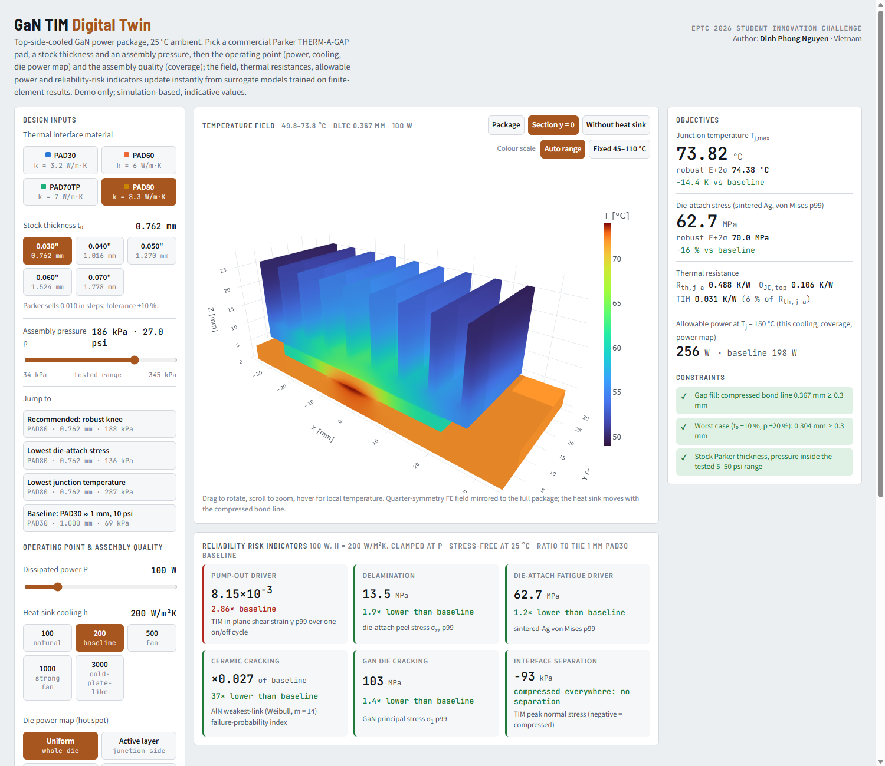

# GaN TIM Digital Twin — interactive demo

Interactive demo of a digital twin for thermal interface material (TIM) selection in a top-side-cooled GaN power package, prepared for the **EPTC 2026 Student Innovation Challenge**.

**Live demo:** https://dwind-source.github.io/gan-tim-digital-twin/

Choose a commercial thermal pad, its stock thickness and the assembly pressure, then the operating point (power, heat-sink cooling, die power map) and the assembly quality (coverage). The 3-D temperature field, junction temperature, thermal resistance, allowable power and reliability-risk indicators update instantly.

- Simulation-based demo; values are indicative and are not experimental measurements.
- This repository contains only the compiled demo page and the open-source plotly.js library (MIT licence) it uses. The simulation models, data and methods are not included.

Author: **Dinh Phong Nguyen** · VinUniversity, Vietnam

© 2026 Dinh Phong Nguyen. All rights reserved. No licence is granted to copy, modify or redistribute this page or its content.
